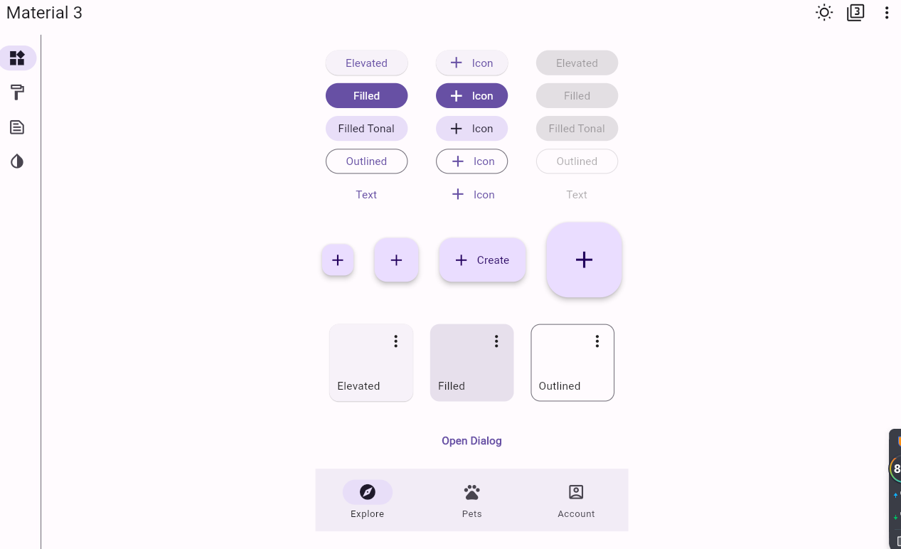

# 一、概述

Flutter 是由 Google 开发和提供支持的开源框架。前端和全栈开发人员使用 Flutter 为具备单一代码库的多个平台构建应用程序的用户界面（UI）。

该 Flutter 示例应用展示了 Flutter Material 库中的 Material 3 特性。这些特性包括经过更新的组件、排版样式、颜色系统以及对阴影效果（高程）的支持。该应用支持浅色和深色主题、不同的调色板，并且具备在 Material 2 和 Material 3 之间进行切换的功能。

**预装环境：**`Extentions: Dart, Flutter` `git` 等。

## 二、快速开始

使用如下命令，快速运行此项目：

```
// 安装依赖
flutter pub get
// 启动应用程序
flutter run -d web-server --web-port 9000 --web-hostname 0.0.0.0
```

**输出结果：**



### 三.  文件结构

```
.
├── analysis_options.yaml 
├── android // 安卓平台相关代码和配置
│   └── ...
├── ios // iOS 平台相关代码和配置
│   └── ...
├── lib
│   ├── color_palettes_screen.dart // 颜色面板屏幕页面代码
│   ├── component_screen.dart // 组件屏幕页面代码
│   ├── elevation_screen.dart // 高程屏幕页面代码
│   ├── main.dart // 项目入口文件
│   └── typography_screen.dart // 排版屏幕页面代码
├── macos // macOS 平台相关代码和配置
│   └── ...
├── test // 测试代码目录
│   ├── color_screen_test.dart // 颜色屏幕测试代码
│   ├── component_screen_test.dart // 组件屏幕测试代码
│   ├── elevation_screen_test.dart // 高程屏幕测试代码
│   └── typography_screen_test.dart // 排版屏幕测试代码
├── web // Web 平台相关资源和配置
│   ├── favicon.png
│   ├── icons // 图标资源目录
│   ├── index.html // Web 应用入口 HTML 文件
│   └── manifest.json // Web 应用清单文件
└── windows // Windows 平台相关代码和配置
│   └── ...
├── pubspec.lock // 项目依赖锁定文件
├── pubspec.yaml // 项目依赖和配置文件
├── README.md // 项目说明文档
├── img               // readme图片目录
|   └── ...                
```

### 2.  Flutter 官方文档与资源

[文档 | Flutter 中文文档 - Flutter 中文开发者网站 - Flutter](https://docs.flutter.cn/?_gl=1*nfa5vr*_ga*MTUxMDc3OTk5MS4xNzM1MTE4NDMz*_ga_HPSFTRXK91*MTczNzYwNDg3OC4zLjAuMTczNzYwNDg3OC42MC4wLjA.)

[Material 3](https://m3.material.io/)

## 三、  常见问题

[Cloud Studio（云端 IDE） 常见问题-文档中心-腾讯云](https://cloud.tencent.com/document/product/1039/33505)

[Cloud Studio（云端 IDE） | Cloud Studio](https://ide.cloud.tencent.com/docs/)

[Cloud Studio 轻量版 帮助文档](https://docs.qq.com/aio/DRUFZcHVvZlJuY3l2?p=1QOiTiIR9g0KMJneBDyfgM)

## 帮助和支持

##### 欢迎加入Cloud Studio用户反馈群

当您遇到问题需要处理时，您可以直接通过到扫码进入Cloud Studio用户群进行提问.

- 腾讯云工程师实时群内答疑

- 扫码入群可先享受产品上新功能

- 更多精彩活动群内优享


